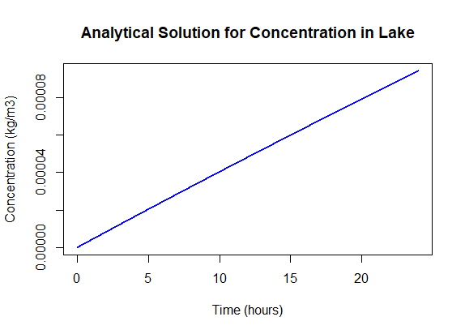

# Lake Pollution Box Model

This R script models how pollutant concentration changes in a lake.
Two rivers bring polluted water into the lake.
The lake is treated as one well-mixed box.

## Equation

The lake follows this mass balance:

V dC/dt = Q1·C1 + Q2·C2 − (Q1 + Q2)·C

The analytical solution is:

C(t) = Cs + (C0 − Cs) · exp(−(Q1 + Q2)·t / V)

Here Cs = (Q1·C1 + Q2·C2) / (Q1 + Q2) is the steady-state concentration.

## Parameters

| Symbol | Meaning | Value | Unit |
|---|---|---|---|
| C0 | Initial lake concentration | 0 | kg/m3 |
| C1 | River 1 concentration | 0.002 | kg/m3 |
| C2 | River 2 concentration | 0.001 | kg/m3 |
| Q1 | River 1 discharge | 7 | m3/s |
| Q2 | River 2 discharge | 100 | m3/s |
| V | Lake volume | 1 × 10^8 | m3 |
| t | Simulation time | 1 day | s |

## Result

Concentration rises almost in a straight line during the first day.
This happens because the lake is very large compared to the river inflow.
The lake needs much longer to reach its steady state.

## How to run

1. Install R from https://cran.r-project.org
2. Open `lake_box_model.R` in RStudio.
3. Click "Source".

No extra packages are needed.

## Author

Shadmin Islam Prova
